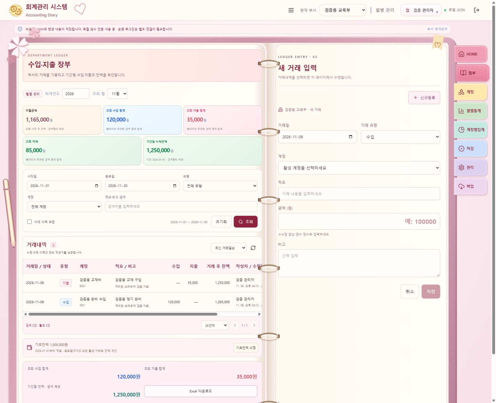
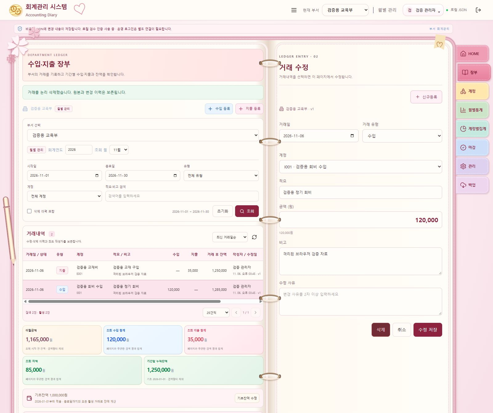
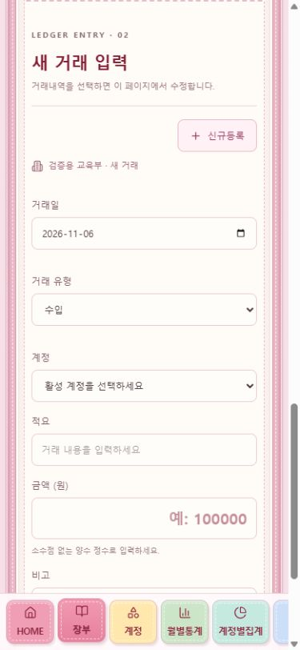

# Diary 장부 — 거래내역과 입력 양면 구성

## 후속 화면 조정

링/인덱스 후속 마감: `src/assets/diary-steel-ring.svg`로 금속 반사·천공·그림자를 표현하고 `diary-spine-fold.svg`로 상단 중앙의 접힘을 추가했습니다. 공통 메뉴를 종이 오른쪽 가장자리에 겹치게 배치하고 접착 음영·기울기·들린 모서리를 적용했습니다. 장식은 입력 이벤트를 받지 않습니다. 타입·메뉴 테스트 6개·빌드·정적 파일 검사 통과. PC 화면과 모바일 가로 넘침 없음(375px)을 확인했습니다. [최신 링·포스트잇 화면](screenshots/diary-steel-sticky-qa.png).

추가 마감: 가죽 결을 별도 SVG 텍스처로 강화하고, 표지 위에 2px 밝은 이중 봉제선을 독립 레이어로 표시했습니다. 장식은 약 300px 높이의 클립·노크 버튼·그립이 있는 볼펜으로 바꿨습니다. 입력 항목 제목은 `#553042`, 굵기 750으로 조정했습니다. PC에서 볼펜 잘림 없음과 제목 스타일을 확인했고, 모바일 가로 넘침이 없으며 볼펜은 입력 공간을 위해 숨깁니다. 변경은 `src/diary.tsx`, `src/visual-refinements.css`, `src/assets/diary-leather.svg`입니다. 타입·빌드·정적 파일 검사 통과. 최신 화면: [가죽 표지와 볼펜](screenshots/diary-leather-ballpoint-qa.png).

- Diary 왼쪽 수입/지출 등록 버튼과 중복 부서 콤보를 제거했습니다. 부서는 공통 헤더에서 선택하고 신규 거래는 오른쪽 신규등록/유형 선택을 사용합니다.
- 기간 선택 → 이월/수입/지출/차액/잔액 → 조회조건 → 거래내역 순서로 배치했습니다. 다른 테마의 장부 순서는 유지합니다.
- 모든 테마의 표 열 제목은 13px/700, 표 영역 제목은 16px/700으로 통일했습니다.
- 다이어리 표지 좌우 폭을 조금 늘리고 가죽 결·그라데이션·봉제선으로 마감했습니다. 종이/입력 영역과 클릭 동작은 유지합니다.
- 변경: `src/ledger.tsx`, `src/diary-ledger.css`, `src/main.tsx`, 신규 `src/visual-refinements.css`.
- TypeScript, 기존 기간 표시 테스트 3개, Vite 빌드와 정적 파일 제외 검사 통과. PC에서 버튼/중복 부서 콤보 0개, 기간·합계·조회조건의 순서와 열 제목 13px/700을 확인했습니다. 모바일 문서 폭/표시 폭 모두 375px로 가로 넘침이 없습니다. 아래는 최초 구현 기록이며 최신 화면은 다음과 같습니다.



2026-11-06. 기존 장부·권한·비공개 JSON 저장소를 재사용했습니다. Modern Dark와 Classic ERP Light에서는 기존 목록과 모달 입력 방식을 유지합니다.

## 구현 완료

- 왼쪽 페이지: 부서, 월별/연도별 기간, 날짜 범위, 수입/지출, 계정, 적요 검색, 조회/초기화, 거래 목록과 페이지 이동.
- 중앙 목록: 거래일·유형·계정·적요·수입·지출·거래 후 잔액. 숫자 우측 정렬과 천 단위 표시. 선택 행은 파스텔 핑크색이며 키보드 Enter/Space로도 선택 가능합니다.
- 오른쪽 페이지: 거래일, 유형, 계정, 적요, 금액, 비고, 수정 사유, 저장/수정/삭제/취소. 기존 거래를 선택하면 즉시 불러옵니다. 신규등록은 새 requestId와 빈 입력으로 초기화합니다.
- 하단: 이월·수입·지출·차액·기간말 잔액과 Excel 다운로드. 합계는 페이지 크기와 관계없이 검색 결과 전체를 대상으로 합니다.
- 미저장 변경이 있는 메뉴 이동, 행 변경, 신규등록, 취소, 부서 변경, 로그아웃은 계속 작성 / 버리고 이동 / 저장 후 이동을 선택합니다. 저장이 실패하면 이동하지 않고 입력을 유지합니다. 새로고침·창 닫기는 브라우저 기본 미저장 경고를 사용합니다. SPA 브라우저 뒤로/앞으로 가기를 별도로 차단하는 기능은 이번 범위에 포함하지 않았습니다.
- 태블릿/모바일에서는 목록 다음 입력폼의 단일 페이지 구성이며, 행 선택·신규등록 시 입력 영역으로 이동합니다. 가로로 긴 표는 내부 스크롤을 사용합니다.

## 잔액 계산

각 거래의 `runningBalance`는 서버에서 기초잔액과 해당 부서 전체 활성 거래로 계산합니다. 날짜 → 생성시각 → ID 순의 확정 순서를 사용합니다. 검색 조건·현재 페이지·표시 정렬에 영향을 받지 않으므로 필터로 제외한 거래도 잔액에 반영합니다. 기초잔액이 없거나 삭제된 거래이면 행 잔액은 미확정으로 표시합니다. 금액은 BigInt 집계와 안전한 정수 범위 검사를 사용합니다.

## Excel

`GET /api/transactions/export.xlsx`는 기존 장부 조회 조건과 인증/현재 부서 권한을 재사용합니다. 현재 페이지에 한정하지 않고 일치하는 전체 자료를 하나의 확정 제어 JSON 참조로 읽어 내보냅니다. 수입/지출 합계, 이월, 기간말 잔액과 조회 조건을 포함합니다. 기존 부서당 20,000개 거래 읽기 한도를 유지합니다.

실제 ZIP 기반 `.xlsx`이며 CSV/HTML에 확장자만 바꾸지 않습니다. 한국어·XML 특수문자·제어문자를 처리하고 사용자 문자열은 수식이 아닌 inline string으로 기록합니다. 일반 금액은 숫자와 천 단위 형식으로 저장합니다. Excel의 15자리 정밀도 제한으로 값이 변하지 않도록 15자리 초과 정수는 문자열로 보존합니다. 매크로·외부 링크는 생성하지 않습니다.

파일 구조 참고: [Microsoft SpreadsheetML 문서](https://learn.microsoft.com/en-us/office/open-xml/spreadsheet/structure-of-a-spreadsheetml-document).

## 검증

- 전체 165개 테스트 통과. 기존 160개에 행 잔액·미설정 잔액·삭제 제외·Excel 전체 결과·권한·파일 직렬화 관련 5개를 추가했습니다.
- 새 테스트는 필터와 페이지 크기에 관계없는 잔액, 데이터 변경 없는 내보내기, 비로그인/다른 부서 접근 차단, 수식처럼 보이는 적요의 문자열 보존, 큰 정수 보존을 검증합니다.
- 브라우저에서 임시 JSON을 사용하여 실제 등록(10,000원), 행 선택 후 수정(15,000원), 저장 후 월별 통계 이동, 재조회, 삭제 사유 입력과 논리삭제를 확인했습니다. 실제 사용자 회계자료에 검증 거래를 만들지 않았습니다.
- 계속 작성 시 입력 유지, 신규등록 전 버리기 확인, 필수 계정 없는 저장 실패 시 이동 차단·입력 유지 확인.
- 다운로드 버튼에서 실제 `.xlsx` 파일을 받았으며 별도 .NET ZIP/XML 판독기로 6개 패키지 구성요소와 워크시트 8개 행(안내/헤더 6 + 실제 거래 2), 수식 셀 0개를 확인했습니다. 실제 Microsoft Excel 앱에서 여는 검수는 수행하지 않았습니다.
- PC 1600px와 모바일 390px 확인. 모바일 문서 폭과 표시 폭 모두 375px(스크롤바 제외), 표는 표시 305px 안에서 930px 내부 스크롤로 작동했습니다.
- TypeScript·Vite 빌드·정적 산출물 비공개 JSON 제외 검사 통과.

## 실행

백엔드 변경이 있으므로 기존 API를 재시작합니다. 터미널 두 개에서 `pnpm server`, `pnpm dev` → `http://127.0.0.1:5173/ledger` → 사용자 메뉴에서 Pastel Diary Book → 부서 선택.

```powershell
node node_modules/typescript/bin/tsc --noEmit
node node_modules/vitest/vitest.mjs run
node node_modules/vite/bin/vite.js build
node scripts/check-dist.mjs
```

## 변경 파일

- 추가: `src/diary-ledger.css`, `src/leave-guard.tsx`, `server/xlsx.ts`, `tests/xlsx.test.ts`, `tests/xlsx-utils.ts`, 이 문서와 장부 검수 스크린샷.
- 수정: `src/ledger.tsx`, `src/main.tsx`, `src/diary-reference.css`, `server/ledger.ts`, `tests/ledger.test.ts`, `README.md`, `docs/progress.md`.

계정 관리·통계·관리자 화면의 양면 수첩 재배치, 마감 실행·백업/복원, 다른 보고서의 Excel 내보내기는 후속 범위입니다. 기존 서버의 마감 후 수정 차단·담당자 권한·감사이력은 유지했습니다. Netlify 원격 쓰기와 운영 인증은 미검증 상태를 유지합니다.




