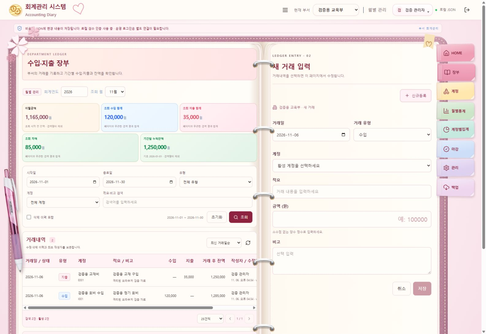

# 첨부 볼펜 사진 적용

내장 imagegen 도구의 배경 제거 편집을 사용했습니다. 첨부한 분홍/흰색 볼펜 사진을 편집 대상으로 사용했고, 결과는 프로젝트의 `src/assets/diary-pink-ballpoint.png`에 저장했습니다. `src/diary.tsx`에서 참조하며 CSS로 높이 350px, -8도 기울기, 부드러운 드롭 섀도를 적용했습니다. 기존 코드로 그린 볼펜은 교체했습니다. 모바일에서는 기존처럼 장식을 숨깁니다.

최종 편집 프롬프트:

> Edit target: attached pink and white retractable ballpoint pen product photograph. Background-extraction only. Preserve the exact pen silhouette, materials, white clip, pink translucent barrel, purple rubber grip, white cone and metal nib. Remove the entire white background and original cast shadow to a genuinely transparent alpha background. Do not redesign or add objects. Keep pen upright, entire pen visible, trim canvas closely around the pen with a small transparent margin. This is a website decorative asset; rotation and shadow will be applied by CSS later. Save the transparent PNG cutout.

기본 생성 경로에만 의존하지 않고 프로젝트 안으로 복사했습니다. 타입 검사·Vite 빌드·비공개 파일 제외 검사 통과. 격리된 JSON 자료로 PC에서 배치와 그림자를 확인했습니다. 업무 API/데이터는 변경하지 않았습니다.

