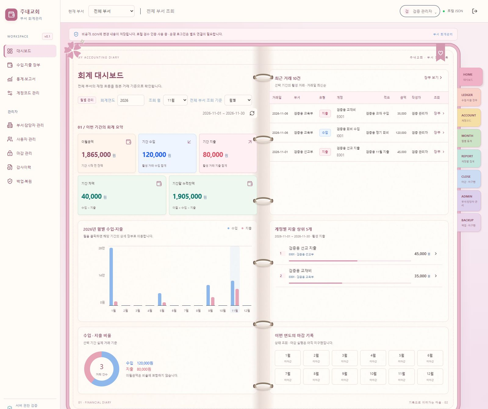
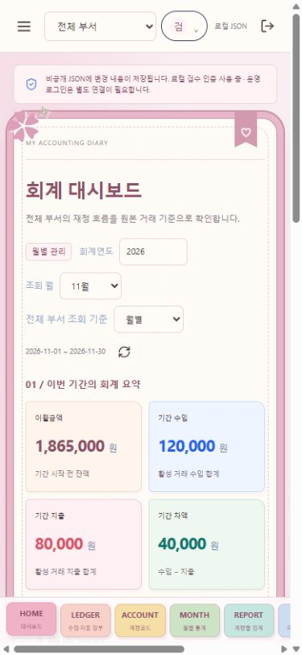

# Pastel Diary Book — 대시보드 우선 구현

## 참고 이미지에 맞춘 외형 후속 조정

상단 로고/부서/사용자 헤더, 전체 너비 다이어리, 버건디 제목 리본, 굵은 한글 글씨, 선명한 파랑·분홍·초록 금액, 도톰한 핑크 표지와 봉제선, 독립 페이지 테두리, 금속 바인더, 아이콘 인덱스, 꽃·북마크·펜·마스킹테이프를 조정했습니다. 기존 좌측 메뉴는 다이어리 테마에서 헤더의 메뉴 버튼으로 열 수 있습니다. Modern Dark와 Classic ERP Light에는 이 외형 변경을 적용하지 않습니다.

추가 파일: `src/diary-reference.css`. 수정 파일: `src/diary.tsx`, `src/main.tsx`. 글꼴은 외부 다운로드 없이 둥근 영문 글꼴과 Malgun Gothic/Apple SD Gothic Neo 대체 글꼴을 사용하며 제목·금액의 굵기와 자간을 조정했습니다. 원본 캐릭터/상표는 복제하지 않았고 실제 회계 기능/자료는 변경하지 않았습니다.

후속 조정의 타입 검사·Vite 빌드·정적 파일 제외 검사는 통과했습니다. 브라우저 연결 시간 초과로 이 조정 이후의 새 화면 캡처와 기기별 육안 검증은 완료하지 못했습니다. 아래 154개 테스트 및 화면 캡처는 최초 테마 구현 시 기록입니다. 최신 화면은 `/`에서 Pastel Diary Book을 선택하여 확인합니다.

2026-11-06. 이번 범위는 테마 기반·수첩 공통 장식·대시보드입니다. 장부와 나머지 화면의 양쪽 페이지 재배치는 디자인 확인 후 진행합니다.

## 기존 구조 분석

React Router의 `Shell`이 로그인 후 공통 메뉴·헤더와 업무 화면을 표시하고, `DashboardPage`가 기존 통계 API에서 자료를 읽습니다. 기존 테마는 Modern Dark 하나뿐이었고 테마 선택/저장은 없었습니다. 요청에 언급된 Classic ERP Light는 기존 소스에 없어 이번에 기존 ERP 배치를 사용하는 별도 밝은 테마로 추가했습니다.

## 완료한 내용

- 상단 사용자 메뉴에서 Modern Dark / Classic ERP Light / Pastel Diary Book 선택. CSS 변수와 `data-theme`으로 즉시 전환하며 업무 컴포넌트를 다시 마운트하지 않습니다.
- Modern Dark의 기존 스타일·배치를 유지합니다. 다이어리 전용 장식과 비율/마감 카드도 해당 테마에서만 표시합니다.
- 파스텔 표지 프레임·종이 질감·양쪽 페이지·6개 금속 링·천공·북마크·꽃 장식·페이지 번호. 장식은 입력을 받지 않습니다. 캐릭터/상표 복제나 외부 이미지 의존이 없습니다.
- 오른쪽 인덱스는 기존 라우트로 연결합니다. 관리자 메뉴는 관리자에게만 표시하며 미구현 마감·백업은 그렇게 표시합니다. 모바일에서는 하단 가로 스크롤 인덱스입니다.
- 왼쪽: 기존 이월/수입/지출/차액/잔액, 연도·월 선택, 월별 막대차트와 수입·지출 비율. 오른쪽: 실제 최근 거래, 주요 지출, 기존 저장 상태의 월별 마감 기록. 예산·공지·메모 등 없는 기능은 꾸며서 생성하지 않았습니다.
- 1000px 이하에서 단일 페이지, 모바일 바인더 생략, 최근 거래는 내부 가로/세로 스크롤. 최소 모션 설정에서는 페이지 애니메이션을 끕니다.

## 사용자 설정 저장 범위

서버의 현재 인증 사용자를 대상으로 `PATCH /api/me/preferences`를 추가했습니다. 입력은 `theme`, `expectedRevision`뿐이며 다른 사용자 식별자나 권한 필드를 받지 않습니다. 기존 Origin 검사·인증·활성 사용자 재검사·저장소 revision 충돌 검사를 사용합니다.

사용자 레코드에 선택적인 `theme` 메타데이터만 추가했습니다. 기존 자료를 읽을 때 값이 없으면 Modern Dark로 표시하며 거래·계정·부서·권한·회계 계산 구조를 바꾸지 않습니다. 기존 업무 API 및 저장소 구현은 유지했습니다. 설정 저장도 같은 revision 체계를 사용하므로 경합 시 409로 실패하고 화면에 저장 실패를 안내합니다. 회계 입력값을 초기화하거나 저장 충돌을 무시하지 않습니다.

비공개 서버 JSON에 저장되므로 같은 서버를 사용하는 다른 기기의 로그인도 저장된 테마를 읽습니다. 로컬 파일 저장·재시작·두 번째 세션으로 검증했습니다. Netlify 원격 쓰기는 아직 차단되어 있으므로 해당 환경에서는 현재 화면에만 적용하며 계정 저장 불가를 표시합니다. 운영 환경의 기기 간 동기화가 검증됐다고 주장하지 않습니다.

## 테스트 결과

- TypeScript 통과, 전체 **154개 테스트 통과**(기존 147 + 테마 7).
- 신규 테스트: 기존 JSON 호환/기본값, 실제 파일 재개방과 새 로그인 시 유지, 다른 사용자·회계 데이터 불변, 타 사용자/권한 필드 거절, 잘못된 테마 거절, 인증/Origin 검사, revision 충돌, 중지 계정 차단.
- 브라우저: 세 가지 테마 전환, 5월 선택 후 다른 테마에서도 5월 유지, 장부 부서·입력 중 검색어 유지, 새로고침 후 테마 재적용 확인.
- 1600px PC와 390px 모바일 확인. 모바일 문서 폭 375px/내용 폭 375px(스크롤바 제외), 페이지 가로 넘침 없음. 하단 인덱스 터치 영역 확인.
- Vite 빌드와 정적 산출물 비공개 파일 제외 검사 통과. Netlify 실제 배포는 수행하지 않았습니다.
- 화면 검증은 임시 JSON의 검증용 계정을 사용했으며 사용자 회계자료를 검증 데이터로 교체하지 않았습니다.

## 실행·확인

터미널 두 개에서 `pnpm server`, `pnpm dev`. 기존 API 프로세스가 실행 중이면 재시작합니다. `http://127.0.0.1:5173/` → 로그인 → 우측 상단 사용자 메뉴 → 테마 선택 → Pastel Diary Book.

```powershell
node node_modules/typescript/bin/tsc --noEmit
node node_modules/vitest/vitest.mjs run
node node_modules/vite/bin/vite.js build
node scripts/check-dist.mjs
```

## 변경 파일

- 추가: `shared/theme.ts`, `src/theme.tsx`, `src/themes.css`, `src/diary.tsx`, `src/diary-extras.tsx`, `tests/theme.test.ts`.
- 수정: `src/main.tsx`, `src/client.tsx`, `src/dashboard.tsx`, `server/schema.ts`, `server/api.ts`.
- 문서: 이 보고서, `README.md`, `docs/progress.md`, `docs/screenshots/theme-*.png`.

## 다음 단계

대시보드 디자인 확인 후 장부 목록/입력과 계정 관리를 양쪽 페이지로 옮깁니다. 그다음 통계·관리자 화면을 확장합니다. 마감 실행·웹 백업/복원·Excel의 기존 미구현 상태와 운영 인증/원격 저장소 제한은 유지합니다.




