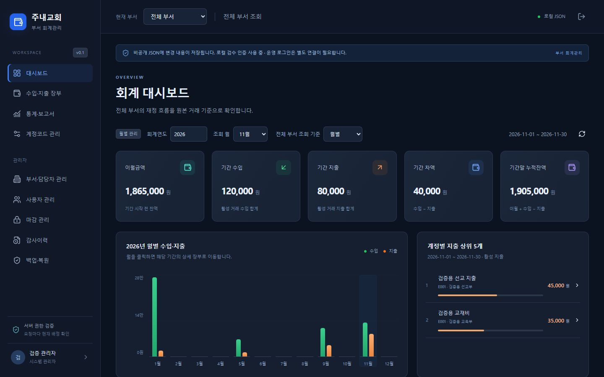
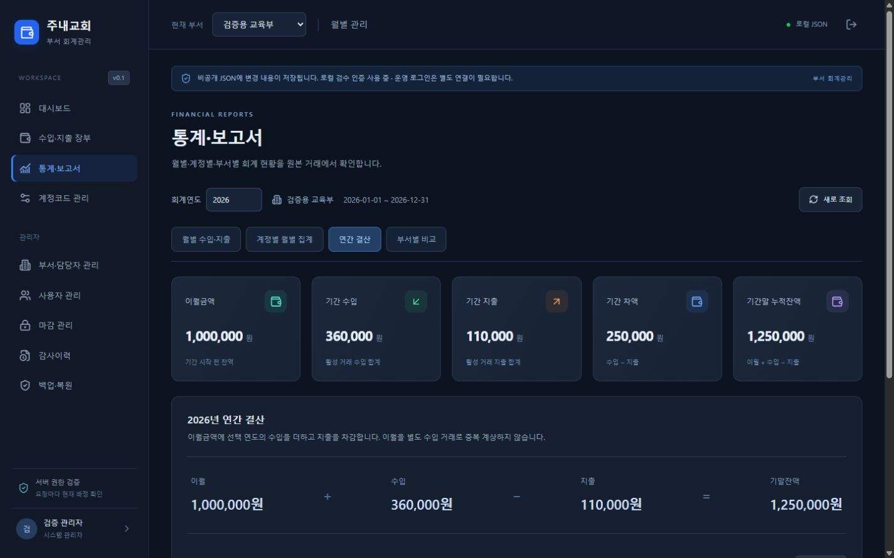

# 3단계 — 통계·대시보드 구현 보고

작성일: 2026-11-06. 요구사항 기준은 원문 `accounting_web_codex_spec.md`와 후속 사용자 요청입니다.

## 구현 완료

| 화면 | 구현 내용 | 상태 |
| --- | --- | --- |
| 대시보드 `/` | 이월·수입·지출·차액·기말잔액, 월별 차트, 최근 거래 10건, 지출 계정 상위 5개 | 완료 |
| 통계 `/reports` | 연도 선택, 월별 표/차트, 계정별 12개월 집계, 연간 결산 조회 | 완료 |
| 관리자 통계 | 전체 부서 통합, 부서별 연간/월간 비교 | 완료 |
| 상세 연결 | 월·부서·계정 금액에서 해당 기간/유형/계정의 실제 장부로 이동 | 완료 |
| 마감 표시 | 저장된 월별 마감 상태 조회 | 완료 |
| 마감 실행 | 월·연도 마감 처리/해제 및 승인 정책 | 미구현, 운영 단계 |

기존 로그인·메뉴·부서 선택·다크 레이아웃을 재사용합니다. 부서의 월별/연도별 기본 설정을 대시보드에 반영하고, 통계 화면은 연도 전체를 분석합니다. 계정표는 가로 스크롤과 첫 열 고정, 작은 화면은 카드와 결산식을 재배치합니다. 예제 데이터는 제품 화면에 삽입하지 않습니다.

## API와 집계 기준

모두 인증된 GET 요청이며 `year`와 선택적 `departmentId`를 받습니다.

- `/api/reports/dashboard`: 추가 `from`, `to`. 선택 기간 요약·최근 거래·지출 순위와 해당 연도 월별 차트.
- `/api/reports/monthly`: 12개월 합계·이월·잔액·마감 상태.
- `/api/reports/account-monthly`: 추가 `type=INCOME|EXPENSE`. 계정별 12개월/연간 합계와 동일 스냅샷 요약.
- `/api/reports/annual`: 연간 요약·월별 결과·부서별 결과·마감 개월 수.
- `/api/reports/departments`: 관리자 전용. 선택적 `month`로 부서 비교 기간 지정.

담당자는 현재 배정된 특정 부서만 조회합니다. 부서 미지정 전체 통계와 부서 비교는 관리자만 가능합니다. 담당자 변경 시 기존 세션에도 최신 권한을 적용하며 거래를 이동하지 않습니다. 서로 다른 부서의 같은 계정코드는 합쳐서 하나의 계정으로 취급하지 않습니다.

제어 JSON이 참조하는 확정 거래 버전을 응답당 읽어 집계합니다. 논리삭제 거래는 제외하고 비활성 계정의 과거 거래는 포함합니다. 이월은 기초잔액과 조회 시작일 이전 거래로 계산하며 수입에 더하지 않습니다. 기초잔액 미설정 부서가 포함되면 통합 이월·잔액은 부분 합계 대신 미설정으로 표시합니다. 정수 범위 초과와 손상 JSON은 오류로 처리합니다. 계정표 요약도 같은 API 응답에서 계산합니다.

## 검증 결과

- TypeScript 검사 통과.
- Vitest **9개 파일, 147개 테스트 통과**. 기존 120개와 통계/장부 링크 관련 신규 27개.
- Vite 배포 빌드 통과.
- `check-dist.mjs` 통과: JSON, 소스맵, 확인 대상 서버 설정/초기 계정 표식이 정적 산출물에 없음. 일반적인 모든 비밀값 탐지 보장은 아닙니다.

통계 테스트는 임시 디렉터리의 실제 FileRepository/API를 사용합니다. 장부·월별·계정별·연간 합계 일치, 이전 연도 이월, 삭제 제외, 비활성 계정, 동일 코드의 부서 분리, 관리자 통합, 권한 변경 직후 기존 세션, 미설정 잔액, 마감 표시, 잘못된 조회 조건, 손상 자료, 합산 오버플로를 검증했습니다. 기존 저장소의 두 프로세스 경합/읽기 무결성 테스트도 통과했습니다.

브라우저는 별도 임시 저장소의 검증용 부서를 사용했습니다. 실제 사용자 저장소에 검증 자료를 넣지 않았습니다. 검증용 연간 통합 수입 560,000원, 지출 155,000원, 이월 1,500,000원, 기말잔액 1,905,000원을 확인했습니다. 특정 계정의 5월 지출 15,000원 클릭 시 해당 부서·월·지출·계정으로 장부가 연결됐습니다. 링크 이동 후 수동 부서 변경을 이전 링크가 되돌리던 문제를 수정하고 재확인했습니다.

1440px PC와 390px 모바일에서 확인했습니다. 모바일 계정표는 내부 스크롤로 표시되고 페이지 가로 넘침 없이 첫 계정 열을 고정합니다.





## 실행

기존 API 서버를 재시작한 뒤 터미널 두 개에서 `pnpm server`, `pnpm dev`를 실행합니다. `http://127.0.0.1:5173/` 또는 `/reports`에 접속합니다. 검증 명령은 다음과 같습니다.

```powershell
node node_modules/typescript/bin/tsc --noEmit
node node_modules/vitest/vitest.mjs run
node node_modules/vite/bin/vite.js build
node scripts/check-dist.mjs
```

## 변경·추가 파일

- API: `server/reports.ts` 추가, `server/api.ts`, `server/ledger.ts` 수정.
- 화면: `src/dashboard.tsx`, `src/reports.tsx`, `src/report-components.tsx`, `src/report-types.ts` 추가.
- 연결/스타일: `src/main.tsx`, `src/ledger.tsx`, `src/styles.css` 수정, `shared/ledger-link.ts` 추가.
- 검증: `tests/reports.test.ts`, `tests/ledger-link.test.ts` 추가, `tests/ledger-period-ui.test.tsx`, `tests/fixtures/ledger-preview.ts` 수정.
- 문서: `README.md`, `docs/progress.md`, 이 보고서와 `docs/screenshots/stage3-*.png`.

## 남은 기능과 다음 단계

다음은 운영 기능 단계입니다. 월별·연도별 마감 실행과 수정 차단/해제 정책, JSON 백업·복원 화면, Excel 내보내기를 구현하고 검증해야 합니다. 기존 담당자 변경·감사이력은 유지했습니다. 이번 연간 결산 화면은 조회이며 마감 실행이나 승인 완료를 의미하지 않습니다.

검증 범위는 로컬 비공개 JSON 저장소입니다. 실제 OIDC 제공자 연결과 Netlify 원격 JSON 쓰기의 동시성·장애·배포 지속성은 미검증이며 원격 업무 쓰기 차단을 유지합니다. 로컬 테스트 통과를 분산 저장소·자동 백업·운영 인증의 보장으로 해석하지 않습니다.
