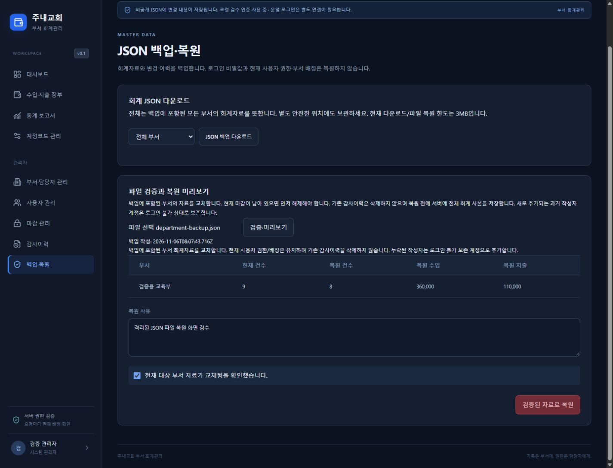

# 운영 기능 구현 및 검증 보고

기준: `accounting_web_codex_spec.md`와 후속 사용자 요청. 2026-11-06.

## 완료 범위

| 단계 | 결과 | 제한 |
| --- | --- | --- |
| 월별·연도별 마감/해제 | 관리자 확인·사유·감사기록, 마감 시점 집계, 원장/기초잔액 검증, 최신 권한·revision 재검사 | 검증된 로컬 파일 저장소에서 동작 |
| JSON 백업/검증/복원 | 전체/담당 부서 회계 백업, 파일 검증, 건수·금액 미리보기, 사유/확인 후 복원, 복원 전 전체 회계 사본 | 현재 파일 3MB 한도. 현재 계정 권한·배정은 복원하지 않음 |
| Excel | 모든 테마 장부 Excel/부서 JSON, 월별·계정별·연간·관리자 부서 비교 Excel | 현재 서버 조회 한도(부서당 20,000거래) 유지 |
| 감사 검색 | 부서/작업자/한국 날짜 기간/작업/사유, 50건 페이지, 실제 발생 시각 최신순 | 일반 담당자는 관리자 감사 화면 접근 불가 |
| 입력 보호 | 메뉴·부서·행/신규 변경·로그아웃·뒤로/앞으로 이동에서 저장/버리기/계속 작성 | 새로고침/창 닫기는 브라우저 기본 경고 |
| 운영 인증·Netlify | 기존 OIDC 코드 검토, 설정 절차, 원격 읽기 해시 검증 어댑터, 실패 차단 테스트와 설정 점검 도구 | **실제 연결·배포·원격 쓰기/복원 검수는 미완료** |

## 마감 규칙

월별 마감은 해당 기간 시작 이전 기초잔액과 확정 원본 거래를 검사하고 수입·지출·이월·잔액·건수를 기록합니다. 같은 로컬 독점 잠금 안에서 사용자 신원/역할과 revision을 재확인하여 게시합니다. 거래 API의 기존 마감 후 등록/수정/삭제 차단도 유지합니다.

연간 마감은 12개월 모두 마감된 뒤에만 가능합니다. 월 마감을 해제하려면 연간 마감을 먼저 해제해야 합니다. 연간 해제만으로 월별 잠금이 풀리지 않습니다. 마감/해제 모두 사유와 변경 전후 정보를 감사이력에 추가합니다. 연간 통계에는 12개월 마감과 별도로 실제 연간 확정 상태를 표시합니다.

## 백업 범위와 복원 보장 범위

형식은 `church-cashbook-finance-v1`. 작성 시각·범위·부서·계정·현재 참조 거래 원본·기초잔액·월/연간 마감·감사이력·작성자 보존 정보를 포함합니다. 세션·비밀키·OIDC subject·현재 계정 역할·담당 부서 배정은 회계 백업/복원 대상이 아닙니다. 시스템 인증 설정까지 되돌리는 전체 시스템 복원이라고 표시하지 않습니다.

담당자는 자신에게 현재 배정된 부서만 내보낼 수 있고, 전체 백업과 모든 복원은 관리자 전용입니다. 부서 백업은 그 부서의 회계 이력 및 필요한 작성자 이름/ID만 포함합니다.

복원은 다음 순서입니다.

1. 3MB 한도, 형식, 체크섬, 범위, 중복, 거래별 내용 해시/참조, 계정/작성자 참조, 기초잔액, 정수 범위, 마감 집계를 검사합니다. 체크섬은 파일 손상 확인이며 발급자 서명이나 신뢰성 증명은 아닙니다.
2. 현재/복원 거래 건수·수입·지출을 미리 봅니다. 현재 마감이 남아 있으면 먼저 감사이력을 남겨 해제해야 합니다.
3. 관리자 확인과 사유, 미리보기 checksum/revision을 제출합니다. 최신 신원/권한과 현재 revision을 잠금 안에서 다시 검사합니다.
4. 현재 전체 회계 사본을 `.private/accounting/backups/`에 저장하고 읽어서 확인합니다. 이 사본이 현재 복원 한도를 넘거나 저장에 실패하면 복원하지 않습니다.
5. 백업 거래를 불변 버전 객체로 저장·검증하고, 참조·회계자료·추가 감사기록을 담은 제어 JSON을 한 번 게시합니다. 부분 저장된 거래 객체는 제어 JSON에서 참조하지 않으면 조회되지 않습니다.

복원은 백업에 **포함된 부서**의 회계 컬렉션을 교체합니다. 다른 부서와 현재 사용자/배정/기존 감사이력은 유지합니다. 없는 과거 작성자는 로그인 불가 보존 계정, 없는 부서는 비활성 상태로 추가합니다. 미리보기 이후 변경은 409이며 다시 검증해야 합니다. 복원 전 백업/게시 실패 시 기존 `current.json` 참조는 유지됩니다. 파일을 직접 삭제하거나 전원 차단/디스크 파손까지 해결하는 보장은 아닙니다. 원본이 이미 손상되어 복원 전 전체 사본조차 읽을 수 없으면 웹 복원은 실패하며 별도 복구 점검이 필요합니다.

## 테스트 결과

TypeScript 통과. Vitest **14개 파일 193개 테스트 통과**. Vite 빌드 및 `check-dist.mjs` 통과. 검증은 임시 디렉터리와 격리된 QA 서버를 사용하고 실제 사용자 `.private/accounting`에 검증 자료를 넣거나 복원을 실행하지 않았습니다.

- 월 마감 집계, 마감 후 관리자 거래 삭제 차단, 사유/감사기록, 12개월 선행 조건, 연간 해제 후 월 마감 유지, 권한 없는/중지된/잘못된 신원 요청 방어.
- 두 마감 요청의 경쟁에서 한 번만 성공/다른 요청 409. 기존 두 프로세스 거래 저장·동일 거래 충돌 테스트도 통과.
- 전체/부서 백업 및 현재 거래 객체 포함, 개인정보 범위, 체크섬 변조/누락 거래/마감 집계 오류 차단, 미리보기 이후 변경 차단.
- 복원 전 사본 저장 실패와 제어 JSON 게시 실패 시 원본 상태 보존. 복원 전 전체 사본에 복원 직전 거래가 포함됨을 검사.
- 통계 Excel 4종의 실제 XLSX 패키지, 담당자 전체/타 부서 내보내기 차단, 3개 테마의 장부 Excel/JSON 버튼 표시.
- 원격 읽기 계약은 가짜 저장소로 해시·ID·version·잘못된 세션 형식 실패 차단을 검사한 것이며 실제 Netlify 통신/지속성 검수는 아님.
- OIDC 흐름 쿠키 누락/위조 시 세션 미발급, HTTPS/키 설정 실패 차단, 운영 API에서 로컬 계정 선택 로그인 차단. 실제 제공자의 state/nonce/token/SSO 검수는 서비스 연결 후 수행해야 함.

브라우저에서는 월 마감/해제, 장부 입력 재개, 뒤로가기/앞으로가기의 계속 작성·입력 보존·버리기를 확인했습니다. JSON 파일 업로드에서 현재 9건→복원 8건, 수입 360,000원/지출 110,000원 미리보기 후 복원을 실행했고, 복원 전 전체 사본 및 `STORAGE_RESTORED` 검색 결과를 확인했습니다. 모바일 백업 화면 폭 375px/표시 폭 375px로 넘침이 없습니다.

## 실행 방법

API 변경이 있으므로 서버를 재시작합니다. 터미널 두 개에서 `pnpm server`, `pnpm dev`. 관리자 로그인 후 `/closings`, `/backups`, `/audit`를 사용합니다. 상단에서 대상 부서를 선택합니다. `/ledger`, `/reports`의 Excel은 세 테마에서 사용할 수 있습니다.

```powershell
node node_modules/typescript/bin/tsc --noEmit
node node_modules/vitest/vitest.mjs run
node node_modules/vite/bin/vite.js build
node scripts/check-dist.mjs
node scripts/check-production.mjs
```

마지막 명령은 설정 값 자체를 출력하지 않습니다. 현재 환경의 6개 설정이 미확인이고 원격 쓰기가 비활성 상태이므로 **의도적으로 종료 코드 1**을 반환합니다. 이 점검을 통과한 것으로 표시하거나 환경변수만으로 원격 쓰기 제한을 해제하지 않습니다.

## 운영 인증과 원격 저장소 — 미완료 이유/다음 작업

현재 운영 인증은 이미 OIDC이며 사용자 로그인을 위한 것입니다. Netlify 배포/저장소 인증과 다릅니다. 기존에 안전한 별도 비밀번호 로그인이 있는 것을 OIDC로 바꾼 것이 아니며, 비밀번호 없는 로컬 검수 인증을 운영에 연결하지 않았습니다. [서비스 선택·변수·설정 절차](production-auth.md)를 참조하세요.

사용자가 현재 OIDC 서비스가 없다고 확인했습니다. 이 작업 환경에서 실제 Netlify 사이트/서버 환경변수도 확인되지 않았습니다. 실제 사이트·OIDC 웹 앱·사용자 sub 매핑이 필요합니다. 앱 세션 로그아웃과 제공자 전역 SSO 로그아웃은 별개이며 후자를 완료했다고 표시하지 않습니다.

Netlify 공식 문서는 조건부 쓰기를 제공하지만 이를 잔액 등 트랜잭션의 대체 수단으로 사용하지 말라고 안내합니다. 따라서 새로 확인한 `onlyIfMatch`를 임의의 금융 트랜잭션 보장으로 간주하지 않았습니다. [Blobs 공식 가이드](https://www.netlify.com/knowledge-base/how-to-store-files-and-objects-with-netlify-blobs/), [Blobs API](https://docs.netlify.com/build/data-and-storage/netlify-blobs/)

현재 Blobs 어댑터는 거래별 읽기와 해시 검증까지 구현했고 실제 연결은 미검증입니다. **원격 회계 변경/마감/복원은 계속 차단**합니다. 운영 JSON 쓰기를 유지하려면 검증된 단일 작성/직렬화 서비스가 필요하거나, 요구사항 문서 2.3절에 따라 관리형 트랜잭션 저장소 전환을 별도 결정해야 합니다. 이 작업에서 새 DB·외부 서버·유료 서비스는 만들지 않았습니다.

운영 검수는 별도의 Netlify 테스트 사이트(해당 사이트의 production context), 별도 저장소, 테스트 사용자/부서로 해야 합니다. 기존 코드가 운영 자료 공유를 막기 위해 Deploy Preview/branch context를 거절하므로 미리보기에서 운영 자료를 억지로 열지 않습니다. 로그인/권한 변조/인수인계/동시 저장/마감 경쟁/저장 장애/백업→복원/재배포 지속성 검증 후 실제 운영 여부를 판정해야 합니다.

## 변경 파일

- 추가: `server/closings.ts`, `server/backups.ts`, `server/report-export.ts`, `src/operations.tsx`, `src/operations.css`, `src/download.ts`, `tests/operations.test.ts`, `tests/production-boundaries.test.ts`, `scripts/check-production.mjs`, 인증 안내/이 보고서/검수 스크린샷.
- 수정: `server/schema.ts`, `server/api.ts`, `server/file-store.ts`, `server/store.ts`, `server/local.ts`, `server/auth.ts`, `server/reports.ts`, `src/main.tsx`, `src/ledger.tsx`, `src/reports.tsx`, `src/report-types.ts`, `src/leave-guard.tsx`, `src/diary.tsx`, `src/diary-extras.tsx`, `tests/ledger-period-ui.test.tsx`, `tests/fixtures/ledger-preview.ts`, `README.md`, `docs/progress.md`.


